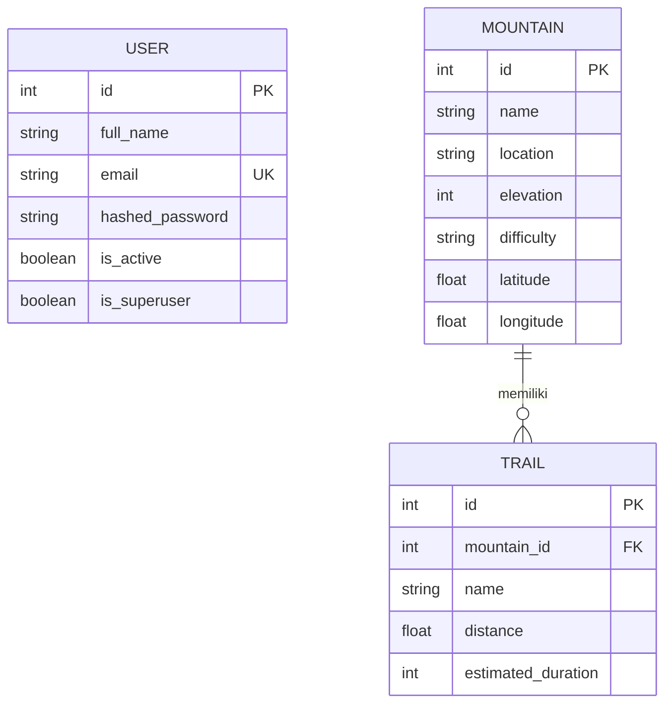

# ⛰️ SafeHike — AI-Powered Mountaineering Platform

> Platform perencanaan pendakian gunung yang cerdas, aman, dan terintegrasi untuk seluruh gunung di Indonesia.

**SafeHike** adalah aplikasi web *full-stack* yang membantu para pendaki merencanakan ekspedisi dengan data katalog gunung Indonesia, prakiraan cuaca *real-time*, statistik pendakian, peta interaktif, serta rekomendasi peralatan dan keselamatan yang dipersonalisasi oleh **Google Gemini AI**.

---

## ✨ Fitur Utama

- **Katalog Gunung Indonesia** — 13+ gunung lengkap dengan lokasi, elevasi, tingkat kesulitan, dan koordinat GPS.
- **Prakiraan Cuaca Real-Time** — Data cuaca puncak gunung via **Open-Meteo API** (gratis, tanpa API key), lengkap dengan *safety advice* otomatis berdasarkan angin, kelembapan, dan suhu.
- **AI Trip Planner** — Rekomendasi peralatan dan peringatan keamanan yang dipersonalisasi berdasarkan gunung, jalur, durasi, dan tingkat pengalaman pendaki.
- **Halaman Detail Gunung** — 5 tab lengkap: Informasi Umum, Prakiraan Cuaca, Jalur Pendakian, Statistik Pengunjung (grafik), dan Peta Topografi.
- **Peta Interaktif** — Integrasi **Leaflet + OpenStreetMap** dengan marker, popup, dan radius 5 km di sekitar puncak.
- **Statistik Pendakian** — Grafik pengunjung per bulan, *summit success rate*, distribusi jalur, dan profil pengalaman pendaki.
- **Autentikasi JWT** — Registrasi & login pengguna dengan *bearer token* (8 hari masa berlaku).
- **UI Modern & Responsif** — React 19 + Tailwind CSS v4 dengan desain gelap premium, *glassmorphism*, dan efek 3D.

---

## 🛠️ Tech Stack

| Layer | Teknologi |
|---|---|
| **Frontend** | React 19, TypeScript, Vite, Tailwind CSS v4, TanStack Query, React Router, Axios |
| **Visualisasi** | Leaflet (peta), Recharts (grafik), Three.js / React Three Fiber (3D) |
| **Backend** | Python 3.12, FastAPI, Uvicorn, Pydantic v2 |
| **Database** | SQLAlchemy 2 (async), SQLite (dev default) / PostgreSQL 15 (via Docker) |
| **Migrasi** | Alembic |
| **AI** | Google Generative AI (Gemini) |
| **Cuaca** | Open-Meteo API |
| **Keamanan** | JWT (python-jose), Passlib + bcrypt |

---

## 🏗️ Struktur Proyek

```
safehike/
├── backend/                     # FastAPI Backend
│   ├── app/
│   │   ├── ai/                  # Integrasi AI (providers, services, prompts)
│   │   ├── api/                 # Router & endpoints (auth, mountains, weather, trip-planner)
│   │   ├── core/                # Konfigurasi & keamanan (JWT, settings)
│   │   ├── crud/                # Operasi database
│   │   ├── db/                  # Koneksi database (async engine)
│   │   ├── models/              # SQLAlchemy models (User, Mountain, Trail)
│   │   ├── schemas/             # Pydantic schemas
│   │   └── services/            # Layanan eksternal (weather_service)
│   ├── alembic/                 # Migrasi database
│   ├── .env.example             # Template konfigurasi lingkungan
│   ├── requirements.txt
│   └── seed_data.py             # Seed data 13 gunung Indonesia
│
├── frontend/                    # React + Vite Frontend
│   └── src/
│       ├── components/          # Navbar, MountainCard, WeatherWidget, dsb.
│       ├── pages/               # Dashboard, MountainDetail, auth/Login, auth/Register
│       └── lib/                 # Axios client dengan interceptor JWT
│
└── docker-compose.yml           # PostgreSQL 15 untuk development
```

---

## 📊 Diagram Arsitektur & Relasi

### Entity Relationship Diagram (ERD)



> **Relasi:** Satu gunung (`Mountain`) dapat memiliki banyak jalur pendakian (`Trail`). Model `User` berdiri sendiri dan digunakan untuk autentikasi JWT.

### Alur Kerja Aplikasi

```mermaid
flowchart TD
    A[Pengguna] --> B{Login / Register}
    B -->|JWT Token disimpan di localStorage| C[Dashboard Katalog Gunung]
    B -.->|Tanpa Token: dialihkan ke /login| B

    C -->|Cari / filter| C1[Pencarian & Filter Wilayah]
    C -->|Pilih gunung| D[Halaman Detail Gunung]

    D --> E[Tab: Info Umum]
    D --> F[Tab: Prakiraan Cuaca]
    F -->|GET /weather/{id}| F1[Open-Meteo API]
    F1 --> F2[Saran Keselamatan Otomatis]

    D --> G[Tab: Jalur Pendakian]
    G -->|POST /trip-planner/recommendations| G1[Google Gemini AI]
    G1 --> G2[Rekomendasi Peralatan & Keamanan]

    D --> H[Tab: Statistik]
    H -->|GET /mountains/{id}/stats| H1[Data Statistik]

    D --> I[Tab: Peta]
    I --> I1[Leaflet + OpenStreetMap]

    C & D -->|SQLAlchemy Async| DB[(PostgreSQL / SQLite)]
    B -->|POST /auth/login| DB
```

---

## 🔌 Endpoint API

Semua endpoint memiliki prefix `/api/v1`. Dokumentasi interaktif otomatis tersedia di **Swagger UI**.

### Autentikasi
| Method | Endpoint | Deskripsi |
|---|---|---|
| `POST` | `/api/v1/auth/register` | Mendaftarkan pengguna baru |
| `POST` | `/api/v1/auth/login` | Login (OAuth2 form) → mendapatkan JWT token |
| `GET` | `/api/v1/auth/me` | Mendapatkan profil pengguna yang sedang login |

### Gunung & Jalur
| Method | Endpoint | Deskripsi |
|---|---|---|
| `GET` | `/api/v1/mountains/` | Daftar semua gunung beserta jalurnya |
| `GET` | `/api/v1/mountains/{id}` | Detail gunung berdasarkan ID |
| `POST` | `/api/v1/mountains/` | Tambah gunung baru *(auth)* |
| `POST` | `/api/v1/mountains/{id}/trails` | Tambah jalur pendakian *(auth)* |
| `GET` | `/api/v1/mountains/{id}/stats` | Statistik pengunjung & performa |
| `GET` | `/api/v1/mountains/{id}/info` | Informasi umum gunung (status vulkanik, basecamp, izin, dsb.) |

### Cuaca
| Method | Endpoint | Deskripsi |
|---|---|---|
| `GET` | `/api/v1/weather/{mountain_id}` | Kondisi cuaca real-time di lokasi gunung |

### AI Trip Planner
| Method | Endpoint | Deskripsi |
|---|---|---|
| `POST` | `/api/v1/trip-planner/recommendations` | Rekomendasi pendakian berbasis AI |
| `POST` | `/api/v1/trip-planner/recommendation` | Alias endpoint rekomendasi |
| `POST` | `/api/v1/trip-planner/chat` | Chat bebas dengan AI Safety Assistant |

---

## ✅ Prasyarat

Sebelum memulai, pastikan Anda telah menginstal:

- **Python** 3.11+ (direkomendasikan 3.12)
- **Node.js** 20+ & npm
- *(Opsional)* **Docker** untuk PostgreSQL

---

## 🚀 Instalasi & Menjalankan

### 1. Backend (FastAPI)

```bash
cd backend

# Buat & aktifkan virtual environment
python -m venv .venv
# Windows:
.venv\Scripts\activate
# Linux / macOS:
# source .venv/bin/activate

# Instal dependensi
pip install -r requirements.txt

# Siapkan konfigurasi lingkungan
# Windows:
copy .env.example .env
# Linux / macOS:
# cp .env.example .env

# Jalankan migrasi database (SQLite dibuat otomatis)
alembic upgrade head

# Seed data 13 gunung Indonesia
python seed_data.py

# Jalankan server development
uvicorn app.main:app --reload
```

Backend akan berjalan di **http://localhost:8000** 🎉

### 2. Frontend (React + Vite)

```bash
cd frontend

# Instal dependensi
npm install

# Jalankan server development
npm run dev
```

Frontend akan berjalan di **http://localhost:5173** 🎉

> Vite sudah dikonfigurasi untuk *proxy* `/api` ke `http://127.0.0.1:8000`, sehingga frontend dan backend terhubung otomatis tanpa konfigurasi tambahan.

### 3. *(Opsional)* Database PostgreSQL dengan Docker

Untuk pengembangan yang lebih mendekati produksi:

```bash
# Edit password pada docker-compose.yml terlebih dahulu
docker compose up -d
```

Lalu ubah `DATABASE_URL` di `backend/.env` menjadi:

```
DATABASE_URL=postgresql+asyncpg://postgres:<PASSWORD>@localhost:5432/safehike
```

---

## 🔐 Konfigurasi Lingkungan

Salin `backend/.env.example` menjadi `backend/.env` dan sesuaikan:

| Variabel | Deskripsi | Default |
|---|---|---|
| `DATABASE_URL` | Koneksi database | `sqlite+aiosqlite:///./safehike.db` (dev) |
| `SECRET_KEY` | Kunci rahasia JWT | `b3c6b8c9d0e1f2a3...` (dev) |
| `GEMINI_API_KEY` | API key Google AI Studio | *(kosong — AI berjalan dalam mode mock)* |
| `GEMINI_MODEL` | Model Gemini yang digunakan | `gemini-3.6-flash` |

> 🔑 Dapatkan Gemini API key gratis di [Google AI Studio](https://aistudio.google.com/app/apikey). Tanpa API key, endpoint AI tetap berjalan namun mengembalikan respons simulasi (`MOCK_AI_RESPONSE`).

> ⚠️ **Penting:** Ganti `SECRET_KEY` dengan nilai acak yang kuat sebelum deployment ke produksi.

---

## 📚 Dokumentasi API

Setelah backend berjalan, akses dokumentasi interaktif:

- **Swagger UI:** http://localhost:8000/docs
- **ReDoc:** http://localhost:8000/redoc
- **Health Check:** http://localhost:8000/health

---

## 🧪 Quality & Development

```bash
# Backend — linting & formatting
cd backend
ruff check .
black .

# Frontend — linting
cd frontend
npm run lint

# Frontend — production build
npm run build
```

---

## 🗺️ Roadmap

- [ ] Chat AI *in-app* dengan asisten keselamatan pendakian
- [ ] Booking & izin pendakian terintegrasi
- [ ] Pelacakan GPS *live* saat pendakian
- [ ] Modul komunitas & laporan kondisi jalur dari pendaki
- [ ] Dukungan multi-bahasa (ID/EN)

---

## 🤝 Kontribusi

Kontribusi sangat kami sambut! Silakan *fork* repositori ini, buat *branch* fitur, dan ajukan **Pull Request**. Untuk perubahan besar, buka terlebih dahulu *issue* untuk berdiskusi.

---

## 📄 Lisensi

Proyek ini dibuat untuk tujuan pembelajaran dan pengembangan. Silakan gunakan, modifikasi, dan distribusikan sesuai kebutuhan Anda.
